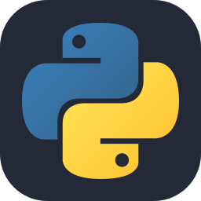
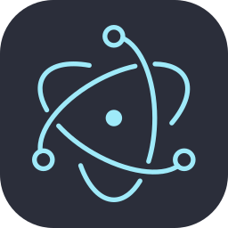
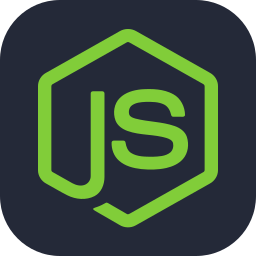
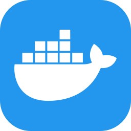
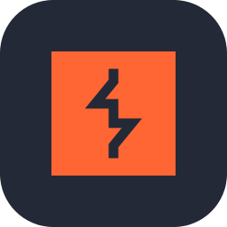
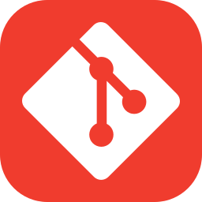

  

### about

I'm learning Python, building desktop apps with Electron and Supabase, and I like trying out new tools.

---

### tech stack

  
  
  
  
  
  
  
  
  

- **language:** Python
- **apps:** Electron · Node.js
- **database & cloud:** Supabase · GitHub Pages
- **devops & security:** Docker · Burp Suite
- **tools:** Git · GitHub · Claude Code · Windows
